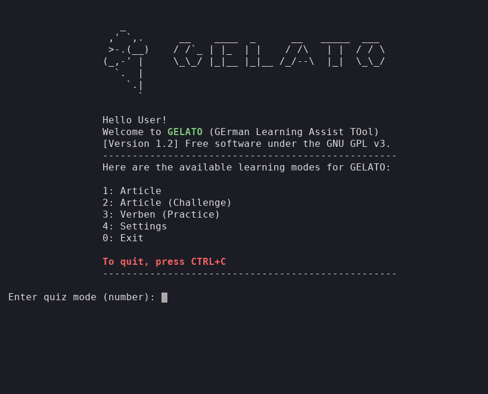

# GELATO



**GE**rman **L**earning **A**ssist **TO**ol. A little terminal quiz for German noun articles (der / die / das) and verb conjugations.

I wrote this as a mini exercise to get to know terminal interaction in Python a bit better, and to make learning the gender of German nouns more fun, since I live in Germany and the articles are the part that never sticks. It is a hobby project, nothing more. If it helps you too, even better.

Documentation: <https://gelato-language.readthedocs.io/>

## Requirements

- Python 3.9 or newer
- pip

## Install and run

```bash
git clone https://github.com/JiaWeiTeh/gelato.git
cd gelato
pip install -r requirements.txt
python gelato.py
```

If you would rather have a `gelato` command that works from anywhere, run `pip install -e .` inside the folder.

## Modes

| Option | Mode | What it does |
| --- | --- | --- |
| 1 | Article | Type der / die / das for each noun. The ones you get wrong come back until you get them right. |
| 2 | Article (Challenge) | Same quiz, but with hearts. Lose them all and the game is over. High scores go to a local scoreboard. |
| 3 | Verben (Practice) | Fill in Präsens, Präteritum and Perfekt for each verb. |
| 4 | Settings | Open the settings file in your editor. |

Press `Ctrl+C` at any time to quit.

## Make it yours

- **Words and verbs** live in `data/artikel.xlsx` and `data/verben.xlsx`. Add your own rows, keep the column headers, and GELATO picks them up the next time it starts. The [customisation guide](https://gelato-language.readthedocs.io/en/latest/customisation.html) has the column layout.
- **Your name, the interface language, the number of hearts and the default number of questions** are in `settings/settings.yml`, or pick mode 4 in the menu. There is also a cat mode (`katze`) that replaces every prompt with meows.

Everything stays on your machine. Scoreboards are written to `data/` and ignored by git.

## License

GNU GPL v3. See [LICENSE](LICENSE).
