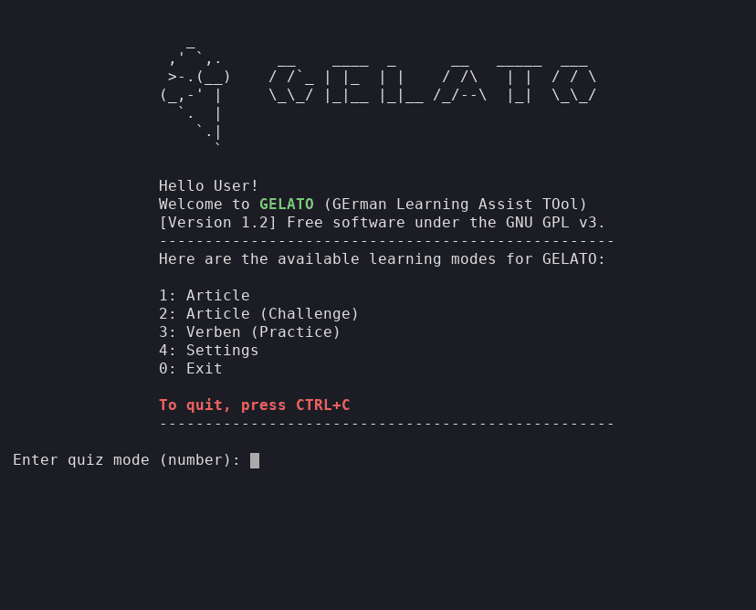

# GELATO



**GE**rman **L**earning **A**ssist **TO**ol. A little terminal quiz for German noun articles (der / die / das) and verb conjugations.

I wrote this as a mini exercise to get to know terminal interaction in Python a bit better, and to make learning the gender of German nouns more fun, since I live in Germany and the articles are the part that never sticks. It is a hobby project, nothing more. If it helps you too, even better.

## Install and run

You need Python 3.9 or newer.

```bash
git clone https://github.com/JiaWeiTeh/gelato.git
cd gelato
pip install -r requirements.txt
python gelato.py
```

If you would rather have a `gelato` command that works from anywhere, run `pip install -e .` inside the folder.

## Modes

| Option | Mode | What it does |
| --- | --- | --- |
| 1 | Article | Type der / die / das for each noun. The ones you get wrong come back until you get them right. |
| 2 | Article (Challenge) | Same quiz, but with hearts. Lose them all and the game is over. The top three scores are kept. |
| 3 | Verben (Practice) | Fill in Präsens, Präteritum and Perfekt for each verb. The example sentence is shown but not checked. |
| 4 | Settings | Open the settings file in your editor. |
| 0 | Exit | |

After each quiz you are back at the menu. Press `Ctrl+C` at any time to quit.

## Add your own words

The word lists are Excel files in `data/`. Add rows below the header and GELATO picks them up the next time you start a quiz.

`data/artikel.xlsx`

| Artikel | Noun | Meaning | Tag |
| --- | --- | --- | --- |
| das | Kind | Child | Familie |

`data/verben.xlsx`

| Infinitiv | Präsens (er/sie/es) | Präteritum | Perfekt | Beispielsatz |
| --- | --- | --- | --- | --- |
| abfahren:depart | fährt ab | fuhr ab | ist abgefahren | Der Bus fährt um 09.12 Uhr ab. |

In the verb list, the column headers become the questions, and the meaning after the `:` is optional.

## Settings

Edit `settings/settings.yml`, or pick mode 4 in the menu.

| Setting | Default | What it does |
| --- | --- | --- |
| `general.name` | `User` | Name in the greeting, up to 10 characters. `null` hides the greeting. |
| `general.def_language` | `en` | Interface language: `en`, `cn` (Chinese) or `katze`, where every prompt becomes a meow. |
| `artikel_normal.def_qs` | `null` | Number of questions when you just press Enter. `null` means every word. |
| `artikel_challenge.hearts` | `3` | Hearts in Challenge mode, from 1 to 10. |

To add another interface language, add a translation under a new code (say `fr`) to the entries in `language/dictionary.py`, then set `def_language: fr`. Anything without a translation stays in English.

The Challenge scoreboard is saved in `data/artikel_scoreboard.csv`. Delete that file to reset it. It stays on your machine and is ignored by git.

## License

GNU GPL v3. See [LICENSE](LICENSE).

Special shout-out to the German language.
